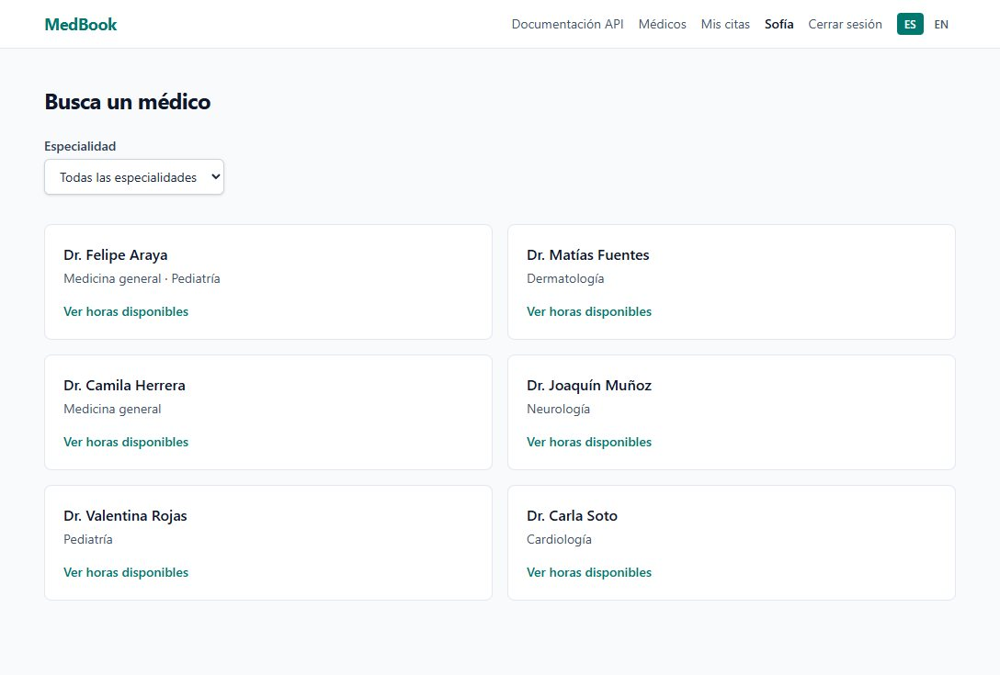
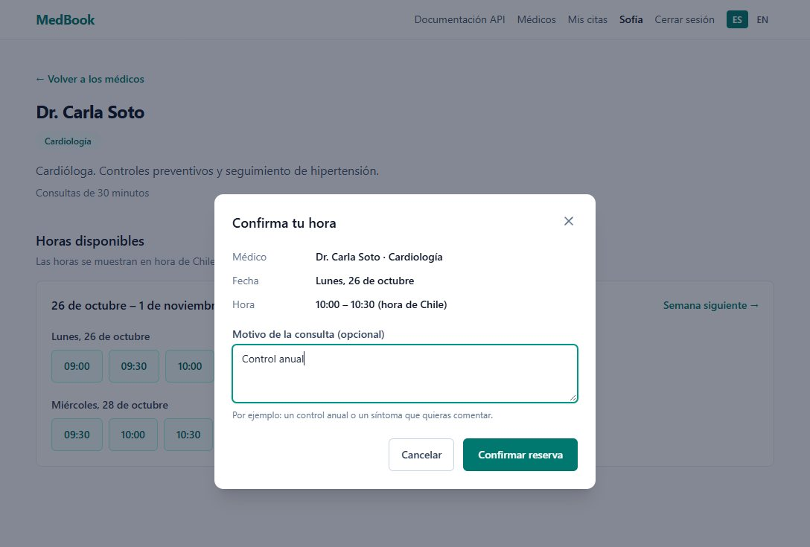
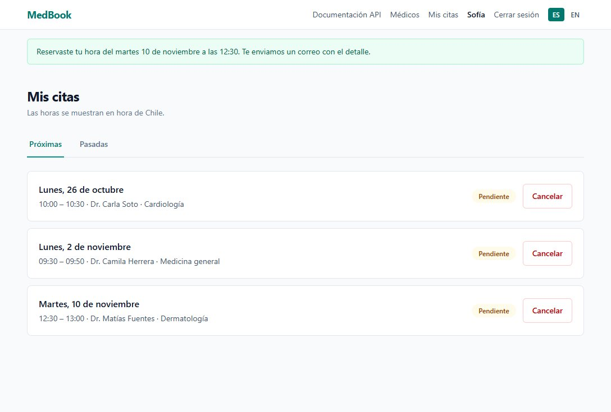
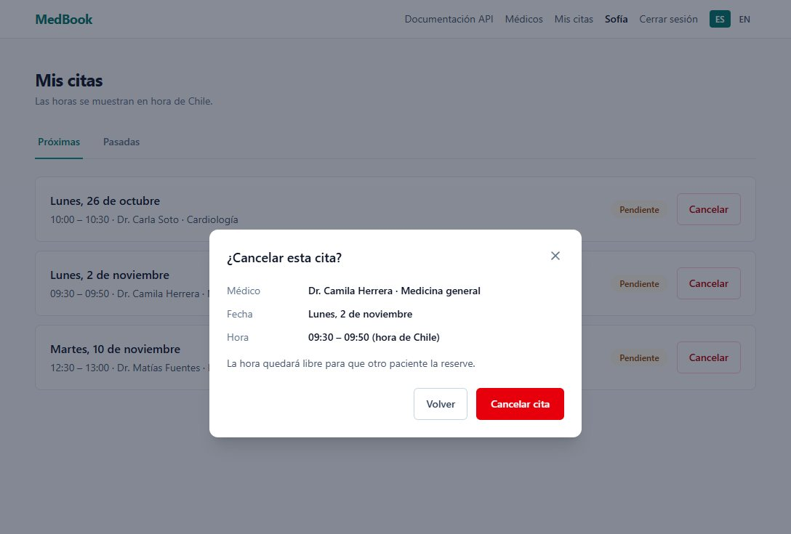
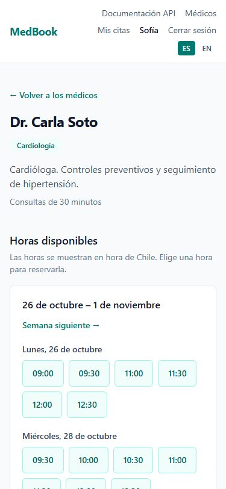

# MedBook API

> REST API for medical appointment booking — Django 5.2 LTS + DRF 3.18  
> Portfolio project built with TDD: appointment state machine, object-level RBAC and race-safe booking.

[](./tests)
[](./tests)
[](https://python.org)
[](https://djangoproject.com)

**[Leer en Español →](./README.es.md)**

---

## What is MedBook?

MedBook is a REST API for managing medical appointments. It covers the full booking lifecycle: doctors publish their weekly schedules, the system generates concrete time slots, patients book them, and appointments move through a state machine (pending → confirmed → completed / cancelled / no-show).

The goal is to demonstrate real-world Django competency: complex ORM queries, RBAC permissions, atomic transactions, TDD, custom admin, and clean architecture — the kind of things that come up in senior backend interviews.

Patients also get a server-rendered web UI (Django templates + HTMX, Spanish and English) built on the same service layer ([ADR 0002](./docs/adr/0002-server-rendered-web-frontend.md)). They can sign up, find a doctor by specialty, book a slot and manage their appointments. The live demo, with six fictional doctors, runs at **https://medbook-oiio.onrender.com**. It is on Render's free plan, so the first request after a quiet spell can take about a minute.

### Screenshots

The UI is in Spanish, its default language; English is one click away in the menu.

| Doctor catalog | Booking a slot |
|---|---|
|  |  |
| **My appointments** | **Cancelling an appointment** |
|  |  |



---

## Stack

| Layer | Technology | Version |
|---|---|---|
| Language | Python | 3.12 |
| Framework | Django | 5.2 LTS (5.2.18) |
| REST | Django REST Framework | 3.18.3 |
| Auth | djangorestframework-simplejwt | 5.5.1 |
| Filtering | django-filter | 26.x |
| API docs | drf-spectacular (OpenAPI 3) | 0.30.0 |
| Email | django-anymail (Resend) | 15.x |
| CORS | django-cors-headers | 4.9.0 |
| Static files | whitenoise[brotli] | 6.8 |
| Web UI | Django templates + HTMX (vendored) + django-htmx | 2.0.11 / 1.29 |
| CSS | Tailwind CSS via django-tailwind-cli (standalone CLI, no Node) | 4.3.3 / 4.8 |
| Database | PostgreSQL 16 | — |
| Tests | pytest-django + factory-boy | — |
| Lint | ruff | — |

---

## Architecture

```
medbook/
├── apps/
│   ├── core/           # Shared: permissions, exceptions, pagination, throttling
│   ├── users/          # Custom User model (AbstractBaseUser) + JWT auth
│   ├── doctors/        # Doctor, Specialty, Schedule models + signals
│   ├── patients/       # Patient model
│   ├── appointments/   # TimeSlot, Appointment, MedicalNote + state machine
│   ├── notifications/  # Email notification services
│   └── web/            # Server-rendered UI: templates, views, Tailwind source (no models)
├── config/
│   ├── settings/       # base.py / local.py / test.py / production.py
│   └── urls.py
├── locale/es/          # Spanish catalog for the web UI (.po + compiled .mo)
├── static/             # Vendored JS (HTMX) + compiled Tailwind CSS (generated)
└── tests/
    ├── unit/           # Pure logic: models, services (no HTTP)
    └── integration/    # Full HTTP stack: URL → ViewSet → DB
```

### Layer responsibilities

| Layer | Responsibility | What does NOT go here |
|---|---|---|
| `models.py` | Fields, relationships, state transitions | Business logic |
| `serializers.py` | Input validation, output formatting | ORM queries, business rules |
| `views.py` | HTTP: auth, permissions, serialization, status codes | ORM direct, business rules |
| `services.py` | All business logic | Anything HTTP-related |
| `permissions.py` | One check per class | Business logic |

### The 15-line rule

If a `validate_*` method, a ViewSet action, or a model method exceeds ~15 lines → extract to `services.py`. No exceptions.

---

## Domain model

```
User (AbstractBaseUser)
 ├── Doctor ──── Specialty (M2M)
 │        └──── Schedule (weekly availability)
 │                   └──── TimeSlot (concrete bookable slots)
 └── Patient
           └──── Appointment ──── TimeSlot (FK: history, one active appointment)
                      └──── MedicalNote
```

### Appointment state machine

```
pending ──────────► confirmed ──────────► completed
   │                    │
   │                    ▼
   └──────────────► cancelled              no_show (from confirmed)
```

Valid transitions:
- `pending → confirmed` (doctor confirms)
- `pending → cancelled` (patient or doctor cancels, before the slot starts)
- `confirmed → completed` (doctor marks complete)
- `confirmed → cancelled` (patient or doctor cancels, before the slot starts)
- `confirmed → no_show` (doctor marks no-show)

Any other transition raises `InvalidTransition` (a `ValueError`), which the API answers with 400. Once its slot has started, nobody can cancel an appointment: the doctor closes it as completed or no-show.

---

## API Endpoints

Base URL: `/api/v1/`  
Auth: `Bearer <access_token>` header  
Docs: `GET /api/docs/` (Swagger UI)  
Datetimes: ISO 8601 in Chilean time with its offset, e.g. `2026-01-14T09:00:00-03:00` (stored in UTC). Doctor schedules are interpreted in `America/Santiago` — see [ADR 0003](./docs/adr/0003-clinic-time-zone.md).

### Auth
| Method | Endpoint | Description |
|---|---|---|
| POST | `/api/v1/token/` | Login → `{access, refresh}`. The email is case-insensitive: `Ana@example.com` and `ana@example.com` are the same account |
| POST | `/api/v1/token/refresh/` | Refresh access token |
| POST | `/api/v1/token/blacklist/` | Logout (invalidate refresh token) |

### Users
| Method | Endpoint | Description | Auth |
|---|---|---|---|
| GET | `/api/v1/users/me/` | Authenticated user profile | Any |
| PATCH | `/api/v1/users/me/` | Update first_name, last_name | Any |
| POST | `/api/v1/users/register/` | Patient self-registration → 201 with the profile (no tokens; log in via `/api/v1/token/`). An email already taken in any case → 400. Rate limited to 10/hour per IP | Public |

### Doctors
| Method | Endpoint | Description | Auth |
|---|---|---|---|
| GET | `/api/v1/doctors/` | List doctors (filter: `?specialty=cardiology`) | Any |
| GET | `/api/v1/doctors/{id}/` | Doctor detail with specialties | Any |
| GET | `/api/v1/doctors/{id}/available-slots/` | Available time slots that have not started | Any |

### Schedules
| Method | Endpoint | Description | Auth |
|---|---|---|---|
| GET | `/api/v1/schedules/` | List schedules (doctor: own; admin: all) | Doctor/Admin |
| POST | `/api/v1/schedules/` | Create schedule | Doctor |
| GET | `/api/v1/schedules/{id}/` | Schedule detail | Doctor/Admin |
| PUT/PATCH | `/api/v1/schedules/{id}/` | Update schedule | Owner/Admin |
| DELETE | `/api/v1/schedules/{id}/` | Soft-delete (is_active=False) | Owner/Admin |

### Appointments
| Method | Endpoint | Description | Auth |
|---|---|---|---|
| GET | `/api/v1/appointments/` | List (patient: own; doctor: own; admin: all) | Any |
| POST | `/api/v1/appointments/` | Book appointment | Patient |
| GET | `/api/v1/appointments/{id}/` | Detail | Owner/Admin |
| PATCH | `/api/v1/appointments/{id}/` | Update reason | Owner/Admin |
| DELETE | `/api/v1/appointments/{id}/` | Hard delete | Admin |
| POST | `/api/v1/appointments/{id}/confirm/` | Confirm (pending → confirmed) | Doctor (owner) |
| POST | `/api/v1/appointments/{id}/cancel/` | Cancel, until the slot starts (afterwards 400) | Patient or Doctor (owner) |
| POST | `/api/v1/appointments/{id}/complete/` | Complete (confirmed → completed) | Doctor (owner) |
| POST | `/api/v1/appointments/{id}/no_show/` | Mark no-show (confirmed → no_show) | Doctor (owner) |

### Medical Notes
| Method | Endpoint | Description | Auth |
|---|---|---|---|
| GET | `/api/v1/appointments/{id}/notes/` | List notes | Doctor (owner)/Admin |
| POST | `/api/v1/appointments/{id}/notes/` | Create note | Doctor (owner) |
| GET | `/api/v1/appointments/{id}/notes/{nid}/` | Note detail | Doctor (owner)/Admin |

### Filters available
```
GET /api/v1/doctors/?specialty=cardiology
GET /api/v1/appointments/?status=pending
GET /api/v1/appointments/?date_from=2025-01-01&date_to=2025-12-31
GET /api/v1/schedules/?day_of_week=0&is_active=true
```

---

### Web UI pages
Server-rendered with session auth (the API keeps JWT). Spanish by default, English through the switcher.

| Method | Path | Description | Access |
|---|---|---|---|
| GET | `/` | Home | Public |
| GET, POST | `/signup/` | Patient sign-up; logs the new patient in. Shares the API's `register` rate limit (10/hour per IP) | Anonymous |
| GET, POST | `/login/` | Email (in any case) + password. Shares the API's `login` rate limit (5/minute per IP) | Anonymous |
| POST | `/logout/` | Log out | Signed in |
| GET | `/panel/` | Notice for doctors and admins until their panel ships | Doctor, admin |
| GET | `/doctors/` | Doctor catalog, `?specialty=<slug>` filter (HTMX swaps only the list), 10 per page | Patient |
| GET | `/doctors/<id>/` | Doctor profile and one week of available, future slots in Chilean time; `?week=0–3` (HTMX swaps only the week) | Patient |
| GET, POST | `/slots/<id>/book/` | Confirm and book a slot with an optional reason. HTMX loads it into a modal dialog; without JS it is a full page. Success goes to My appointments; a slot that can no longer be booked goes back to the doctor's page on the slot's week | Patient |
| GET | `/appointments/` | My appointments: `?tab=upcoming` (default: not started yet, any status) or `?tab=past`, 10 per page, translated status badges (HTMX swaps only the list) | Patient |
| GET | `/appointments/<id>/` | One of the patient's appointments: doctor, date, time, status, reason. Another patient's is a 404 | Patient |
| GET, POST | `/appointments/<id>/cancel/` | Confirm and cancel, until the appointment starts: frees the slot and emails the patient. HTMX: a modal dialog, then the status updates in place; without JS: a full page, then the appointment's page | Patient |
| POST | `/i18n/setlang/` | Language switcher (sets a cookie) | Public |

**Error pages.** The 403, 404 and 500 pages use the site layout and the visitor's language. The 500 page is rendered without the request or the database, since either may be what failed, so its menu has no account links. If the session expires while the visitor is inside a dialog, the whole page goes to the login, which brings them back to the same page afterwards (`HX-Redirect`).

**Accessibility.**
- A skip link jumps over the menu to the page's `<main>`.
- Everything works with the keyboard. Dialogs are native `<dialog>` modals: Esc closes them and the focus goes back to the link that opened them. After cancelling, the focus moves to the appointment's new status. Week, tab and page links keep the focus when HTMX replaces the content around them.
- Each HTMX update announces a short summary to screen readers in a polite live region, for example "6 doctors found." or "November 2 – November 8: 16 available times.". Flash messages live in a `role="status"` region.
- Repeated links carry hidden context, such as "See available times: Dr. Carla Soto" or "Monday October 26, 10:00".
- Primary buttons use white text on teal-700 (contrast 5.4:1, WCAG AA). The layout works down to 375 px wide.

---

## RBAC — Permission matrix

Role checks live in `apps/core/roles.py` (`is_patient`, `is_doctor`, `is_admin`) and are shared by these DRF classes and the web UI's `PatientRequiredMixin` / `StaffRequiredMixin`, so the two RBAC paths cannot drift. Which appointments a user sees is one rule too: `appointments_visible_to(user)` in `apps/appointments/services.py` (patients theirs, doctors theirs, admins all, anyone else none), used by the API's `AppointmentViewSet` and by the web's My appointments.

**Wired to endpoints:**

| Permission class | Rule | Used by |
|---|---|---|
| `IsDoctor` | `user.role == 'doctor'` | Schedule create |
| `IsPatient` | `user.role == 'patient'` | Appointment create |
| `IsAdminRole` | `user.role == 'admin'` | Appointment delete |
| `IsDoctorOfAppointment` | `appointment.doctor == user.doctor_profile` | confirm / complete / no_show / cancel |
| `IsPatientOfAppointment` | `appointment.patient == user.patient_profile` | cancel |

---

## Local setup

### Prerequisites
- Python 3.12
- PostgreSQL 16 (via Docker or local install)
- Git

### 1. Clone and create virtualenv
```bash
git clone https://github.com/MauriDev94/MedBook.git
cd MedBook
python -m venv .venv
source .venv/bin/activate        # Linux/Mac
# .venv\Scripts\activate         # Windows PowerShell
```

### 2. Install dependencies
```bash
pip install -r requirements/local.txt
pre-commit install
```

### 3. Environment variables
```bash
cp .env.example .env
```

Fill in the empty values of `.env` (it is never committed): `SECRET_KEY`, `POSTGRES_PASSWORD`, `POSTGRES_TEST_PASSWORD` and `DATABASE_URL` (format in `.env.example`, with the same password as `POSTGRES_PASSWORD`). No password or key is written anywhere in the repo, not even for local development; generate them:

```bash
python -c "import secrets; print(secrets.token_urlsafe(50))"   # SECRET_KEY
python -c "import secrets; print(secrets.token_urlsafe(16))"   # database passwords (URL-safe)
```

Without them, Django and `docker compose` stop with an error naming the missing variable.

### 4. Start PostgreSQL and run migrations
```bash
# Postgres on port 5435 with the credentials from your .env
docker compose up -d db

# Apply migrations
DJANGO_SETTINGS_MODULE=config.settings.local python manage.py migrate

# Create admin user
DJANGO_SETTINGS_MODULE=config.settings.local python manage.py createsuperuser
```

### 5. Start the server
```bash
# Compile the CSS once (the first run downloads the pinned Tailwind CLI)
DJANGO_SETTINGS_MODULE=config.settings.local python manage.py tailwind build
DJANGO_SETTINGS_MODULE=config.settings.local python manage.py runserver
```

Open **http://localhost:8000/** for the web UI and **http://localhost:8000/api/docs/** for the interactive Swagger UI.

### Web UI: CSS and translations

- **Tailwind**: while editing templates, run `python manage.py tailwind watch` in a second terminal, or `python manage.py tailwind runserver` to run the watcher and the server in one. The source is `apps/web/styles/tailwind.css` and only scans `apps/web`, so class names must appear there literally (never built from strings). The output `static/css/tailwind.css` is generated and not committed. Render, CI and the Dockerfile compile it at build time.
- **Language**: Spanish is the default. The menu's switcher posts to `/i18n/setlang/`, which stores the choice in a cookie; without the cookie, the browser's `Accept-Language` decides. Dates use the active language's formats and Chilean time. Any `/api/` path is switched back to English, so the JSON API never changes with the visitor's language.
- **Translations**: UI strings are written in English and translated to Spanish (the default language) in `locale/es/LC_MESSAGES/django.po`. Both the `.po` and the compiled `.mo` are committed, because production has no gettext; CI fails if they are out of date. The JSON API always answers in English. Updating them needs GNU gettext:
  - Windows: `winget install mlocati.GetText` (then open a new terminal)
  - macOS: `brew install gettext` · Debian/Ubuntu: `sudo apt install gettext`

  ```bash
  python manage.py makemessages -l es --no-location --no-obsolete
  # translate the new msgstr entries, then:
  python manage.py compilemessages -l es --ignore=.venv
  ```

### Demo data

`python manage.py seed_demo` creates six fictional doctors that cover all five specialties, with Monday-to-Friday hours in Chilean time. It only runs when `MEDBOOK_DEMO_DATA=true` and otherwise skips with a warning. To fill a local database:

```bash
MEDBOOK_DEMO_DATA=true python manage.py seed_demo   # or set it in .env
python manage.py generate_slots --days=28           # the four weeks the web shows
```

- The data lives in [`apps/doctors/demo.py`](./apps/doctors/demo.py): emails on the reserved `medbook.example` domain and `DEMO-` license numbers.
- Demo doctors have no usable password, so they cannot log in (the doctor panel comes in a later sprint). No credential is created or committed.
- It creates no patients: sign up on the web, which is the flow the demo shows.
- It is idempotent. A demo doctor counts as existing when its email (in any case) or its license number is taken, and existing rows are never changed, so edits made in the admin stay.

### Alternative: one-command dev stack with `docker compose up`

`docker-compose.yml` now unifies **app + DB** in a single stack — no manual
`pip install` / `createdb` / `runserver` steps required:

```bash
docker compose up
```

This builds the `web` service from the root [`Dockerfile`](./Dockerfile) and
starts it alongside the `db` (Postgres 16) service. Notes:

- `web` waits for `db`'s healthcheck (`pg_isready`) before starting.
- `web` runs with `DJANGO_SETTINGS_MODULE=config.settings.local` (**not**
  `production` — the production settings force `SECURE_SSL_REDIRECT=True`,
  which would break plain HTTP on `localhost`).
- On every start, `web` runs `python manage.py migrate --noinput` before
  launching `gunicorn`, so the schema is always up to date.
- The API is available at **http://localhost:8000/api/docs/**.
- Static files (admin and web UI CSS) are not served in this stack: it runs
  `gunicorn` with local settings, which have no WhiteNoise. Use `runserver`
  for UI work.
- Secrets (`SECRET_KEY`, `POSTGRES_PASSWORD`) come from your `.env`;
  nothing secret is written in `docker-compose.yml`, and `up` stops with a
  clear message if one is missing. `DATABASE_URL` for `web` is built from
  the same variables.
- `medbook_pgdata` is a regular (non-`external`) named volume, so
  `docker compose up` works out of the box without pre-creating it by hand.
  Run `docker compose down -v` to drop it if you want a clean database.

---

## Deploy

Production runs on **Render**, managed as infrastructure as code: [`render.yaml`](./render.yaml) is a Render **Blueprint** with auto-sync, so any change to it merged into `master` is applied to the service automatically (build/start commands, health check on `/health/`, non-secret env vars). Secrets (`SECRET_KEY`, `DATABASE_URL`, superuser credentials) are kept out of the file and live only in the Render dashboard. The Python version comes from [`.python-version`](./.python-version).

The build runs `tailwind build` before `collectstatic`, because the manifest storage needs the compiled CSS. Translations are not compiled there: the `.mo` files are committed.

### Slot generation in production

The Render free plan has no cron jobs, so `startCommand` runs `python manage.py generate_slots --days=28` on every boot. Free instances sleep after 15 minutes without traffic and boot again on the next request and on every deploy, so slots get topped up whenever the API is in use.

- The command is idempotent: it only inserts missing slots and reports `0 new slots` on a rerun.
- It runs in a subshell. If it fails, a `WARNING` line is logged and gunicorn starts anyway, while a failing `migrate` or `ensure_superuser` still blocks the boot.
- On a paid plan, replace it with a Render cron job (`type: cron`, daily `python manage.py generate_slots --days=28`; minimum USD 1/month) and remove it from `startCommand`.

Production doubles as the portfolio demo: `render.yaml` sets `MEDBOOK_DEMO_DATA=true`, so `startCommand` runs `seed_demo` right before `generate_slots`, in its own subshell. The first boot creates the [demo doctors](#demo-data) and every later one reports `Done. 0 demo doctor(s) created.`

A multi-stage [`Dockerfile`](./Dockerfile) is also included as a **portable alternative** to run the same app anywhere Docker runs (it does not replace the Render deploy):

```bash
docker build -t medbook:latest .
docker run --rm -p 8000:8000 \
  -e SECRET_KEY="<your-secret-key>" \
  -e ALLOWED_HOSTS=localhost,127.0.0.1 \
  -e DATABASE_URL="postgres://<user>:<password>@<host>:5432/medbook" \
  medbook:latest
```

The image is built on **Alpine** in two stages. The builder installs the dependencies (all of them ship musllinux wheels), fetches the musl build of the Tailwind CLI (checked against the release sha256, because django-tailwind-cli does not detect musl), compiles the CSS and runs `collectstatic`. The runtime stage has no build tools and serves the app as a non-root user. Production moves to this image in Paso 32 ([#145](https://github.com/MauriDev94/MedBook/issues/145)).

`docker-compose.yml` (see [Local setup](#alternative-one-command-dev-stack-with-docker-compose-up)) wraps this same `Dockerfile` for **local development only** — it reads its credentials from your `.env`, runs with `DEBUG=True`, and is not used for the Render deploy.

---

## Running tests

Tests run against a real PostgreSQL database (same as production).

Tests run with **branch coverage** as the honest standard — not just line coverage. A branch miss means an `if/else` path was never exercised, which line coverage hides.

```bash
# Full suite with coverage
pytest

# Only unit tests (fast)
pytest tests/unit/

# Only integration tests
pytest tests/integration/

# With verbose output
pytest -v

# Stop on first failure
pytest -x

# Specific test file
pytest tests/integration/test_appointments_api.py
```

### Test database setup
```bash
# Create test PostgreSQL database (first time only)
createdb medbook_test          # or via Docker on port 5436
# See .env.test.example for configuration
```

Current stats: **335 tests · 99.4% branch coverage · 0 failures**

---

## Key architectural decisions

See [`docs/architecture.md`](./docs/architecture.md) for full decision log with tradeoffs.

Quick summary:

- **Custom `AbstractBaseUser`** instead of Django's default — email as username, explicit `role` field, no unused fields
- **Services layer** for all business logic — ViewSets are thin HTTP handlers, services own the rules
- **`@transaction.atomic` + atomic UPDATE** to prevent race conditions on slot booking
- **Partial unique index** (`one_active_appointment_per_slot`): a slot keeps its cancelled appointments and can be booked again, but never holds two active ones ([ADR 0004](./docs/adr/0004-slot-appointment-history.md))
- **State machine on the model** — transition methods (`confirm()`, `cancel()`) with explicit `ValueError` guards
- **`select_related` everywhere** — zero N+1 queries by convention
- **factory_boy** for all test data — zero JSON/YAML fixtures
- **locmem email backend** in tests — `mail.outbox` assertions, no real SMTP needed
- **`AnonRateThrottle`** on login endpoint — brute-force protection without throttling the entire API
- **WhiteNoise** for production static files — serves CSS/JS from Gunicorn without Nginx, with Brotli compression and cache-busting hashes
- **Server-rendered web UI** — Django templates + HTMX and Tailwind without Node, calling the same services as the API; one small script for the dialogs ([ADR 0002](./docs/adr/0002-server-rendered-web-frontend.md))

---

## Project conventions

```bash
# Lint (auto-runs on commit via pre-commit)
ruff check . && ruff format --check .

# Generate slots for next 30 days
python manage.py generate_slots --days=30

# Create the demo doctors (needs MEDBOOK_DEMO_DATA=true)
python manage.py seed_demo

# Validate OpenAPI schema
PYTHONIOENCODING=utf-8 python manage.py spectacular --validate --fail-on-warn
```

Commit format: `feat|fix|refactor|docs|test(scope): description`

---

## License

MIT
